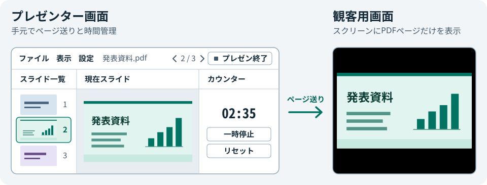
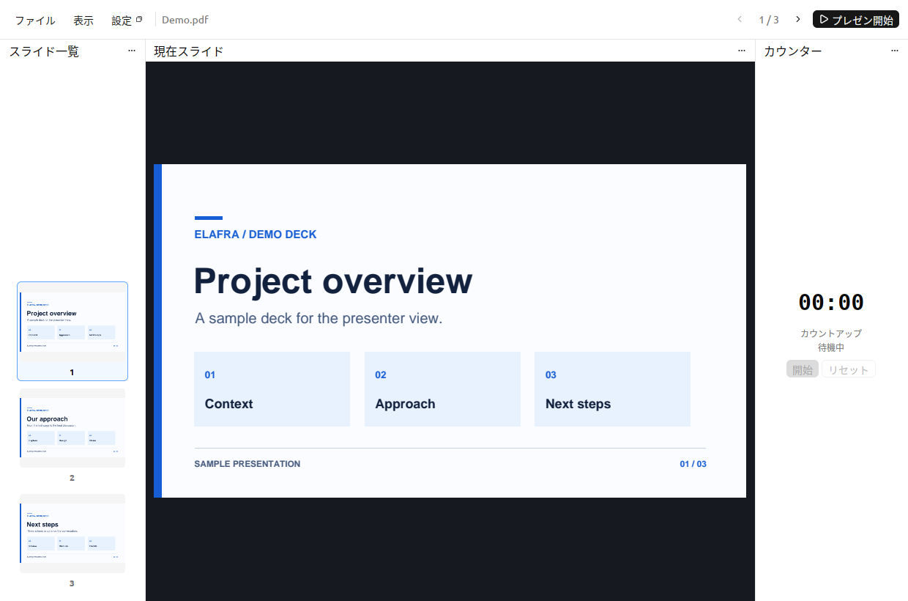

# Elafra

PDFを発表するためのデスクトップアプリ。手元のプレゼンター画面で一覧とタイマーを見ながらページを送り、観客には別ウィンドウのスライド画面でPDFを映す。

[ダウンロード](https://github.com/Ki2Neon/elafra/releases/latest) · [プレゼンを始める](#プレゼンを始める) · [困ったとき](#困ったとき)

*画面構成のイメージ*

## ダウンロードと起動

リリースページの **Assets** から、使うOSに合うファイルを選ぶ。 [GitHub Releases](https://github.com/Ki2Neon/elafra/releases/latest)

### Windows 10 22H2／11 x64

- **インストーラー** — `win-x64-setup.exe` で終わるファイルを実行し、スタートメニューから **Elafra** を開く。
- **ポータブル版** — `win-x64.zip` で終わるファイルを、書き込み可能な場所にすべて展開して `elafra.exe` を開く。設定と履歴は展開先の `settings.json` に保存する。

Windowsには **Visual C++ v14 Redistributable（x64）** が必要。 [Microsoftのダウンロードページ](https://learn.microsoft.com/ja-jp/cpp/windows/latest-supported-vc-redist)

### macOS・Linux

- **macOS 15以降** — Apple Siliconは `mac-arm64.zip`、Intelは `mac-x64.zip` で終わるファイルを展開し、`Elafra.app` を開く。
- **Ubuntu 24.04 x64** — `linux-x64.tar.gz` で終わるファイルを展開し、`elafra` を開く。X11またはXWaylandとVulkan対応ドライバーが必要。

## プレゼンを始める

1. **PDFを開く** — 起動時に開くプレゼンター画面へPDFをドロップする。メニューから開くときは **ファイル → PDFを読み込む…**。前に開いた資料は **ファイル → 最近開いたPDF** から選べる。
2. **観客用の画面を出す** — 一覧で最初に映すページを選び、右上の **プレゼン開始** を押す。モニターが1台なら別ウィンドウ、複数なら別モニターを優先して全画面にする。映す場所は **表示 → 投影先** で選べる。
3. **ページを送る** — `←`・`→` または一覧クリックで手元と観客側のページが切り替わる。投影中に初めてページを移動したとき、カウンターが自動で動き始める。終わったら **プレゼン終了** または `Esc`。

*サンプルPDFを開いたプレゼンター画面*

### キーボード操作

| 操作 | キー |
| --- | --- |
| PDFを開く | `Ctrl+O`（macOSは `⌘+O`） |
| プレゼン開始 | `F5` |
| 前のページ／次のページ | `←` または `Page Up` ／ `→` または `Page Down` |
| 観客用ウィンドウの全画面を切り替える | `F11` |
| プレゼン終了 | `Esc` |

## 手元の画面を調整する

各パネルのタブをドラッグすると配置を変えられる。境界をドラッグするとサイズを変更でき、閉じたパネルは **表示** メニューから呼び戻せる。

| 変えたいこと | 操作 |
| --- | --- |
| 経過時間と残り時間を切り替える | **カウンター** を右クリックして **カウントアップ** または **カウントダウン** を選ぶ。持ち時間は **カウントダウン時間を設定…** で入力する。 |
| 一覧の並び方を変える | **スライド一覧** を右クリックし、**並び方** から **縦並び**、**横並び**、**グリッド** を選ぶ。 |
| 手元で縦長スライドを読む | **現在スライド** を右クリックし、ページ全体を収める **全体表示**、または横幅を使って拡大・スクロールする **横幅に合わせる** を選ぶ。 |
| テーマや先読み容量を変える | ツールバーの **設定** を開く。観客用キャッシュの初期値は128 MB。`0 MB` にすると観客用の先読みが止まる。 |

パネルの配置と設定は、Elafraを再起動しても引き継がれる。

## 困ったとき

- **プレゼン開始を押せない** — 先にPDFを開く。PDFを開いていないときは **現在スライド** にある **ファイルを開く** も使える。
- **観客側が違う画面に出た** — **表示 → 投影先** でモニターを選ぶ。自動配置に失敗したら、観客用ウィンドウを目的のモニターに移し、`F11` で全画面にする。
- **両方のモニターが同じ表示になる** — OSのディスプレイ設定で画面を拡張してから投影する。
- **別のPDFを映したい** — 新しいPDFの読み込みが成功すると今の投影が終了する。新しい資料のページを選んで、**プレゼン開始** を押す。
- **ツールバーに「メモリ不足」と出る** — メモリを使っているアプリを閉じてからやり直す。資料やページを開けなかったときは直前の表示が残る。通知にマウスを置くと詳細が表示される。

macOS・Linuxで起動やファイル選択につまずいた場合

- **macOS** — アプリにはアドホック署名が付いている。初回起動時にGatekeeperが開発元の確認を求める場合がある。
- **Ubuntu** — 実行時ライブラリが不足する場合は `sudo apt install libxcb1 libxkbcommon0 libxkbcommon-x11-0` で追加する。ファイル選択が開かない場合は、デスクトップ環境に合うXDG Desktop Portalを確認する。Ubuntu GNOMEでは `xdg-desktop-portal-gnome`、代替のファイル選択には `zenity` を使える。

## 開発・配布

Rust、GPUI、PDFiumを使用。ソースからの起動、テスト、パッケージの作成、自動リリース、描画とメモリの仕様は開発者向けガイドを参照。 [開発者向けガイド](docs/development.md)
